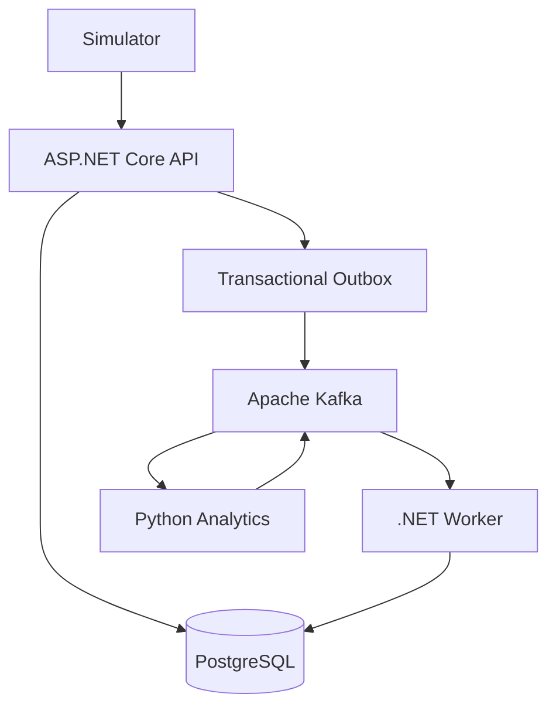

# 🚛 FleetCare

**FleetCare** — система мониторинга состояния автопарка, анализа телеметрии транспортных средств и автоматизации технического обслуживания.

Система позволяет отслеживать техническое состояние автомобилей, выявлять потенциальные неисправности, контролировать интервалы обслуживания и управлять ремонтными заявками.

## 🚀 Основные возможности

### Мониторинг транспорта
- Сбор и хранение телеметрии автомобилей.
- Отслеживание пробега и температуры двигателя.
- Регистрация кодов неисправностей.
- Просмотр истории показаний и состояния транспортных средств.

### Управление техническим обслуживанием
- Контроль интервалов планового ТО.
- Автоматическое создание заявок на обслуживание.
- Управление статусами ремонтных заявок.
- Предотвращение создания дублирующихся заявок.

### Анализ технического состояния
- Анализ температурных показаний двигателя.
- Обнаружение аномалий и потенциальных неисправностей.
- Выявление устойчивых отклонений от нормальных значений.
- Формирование предупреждений для диспетчера.

Python-аналитика температурных отклонений и страница
`/dashboard/risks` реализованы. [Как запустить и проверить](docs/analytics.md).

### Обработка событий
- Асинхронный обмен сообщениями через Apache Kafka.
- Надёжная публикация событий с использованием Transactional Outbox.
- Защита от повторной обработки сообщений.
- Восстановление обработки после сбоев.

## 🛠 Технологический стек

| Категория | Технологии |
|---|---|
| Backend | C#, .NET 10, ASP.NET Core |
| ORM | Entity Framework Core |
| Database | PostgreSQL |
| Message Broker | Apache Kafka |
| Background Processing | .NET Worker Service |
| Analytics | Python |
| Testing | xUnit, Testcontainers |
| Containerization | Docker, Docker Compose |
| Orchestration | Kubernetes, Helm |
| Monitoring | Grafana, OpenTelemetry |

## 🏗 Архитектура

FleetCare построен на принципах разделения ответственности между компонентами системы.

**Основные компоненты:**

- **FleetCare.Api** — REST API для приёма телеметрии, управления автомобилями и ремонтными заявками.
- **FleetCare.Worker** — фоновая обработка событий и выполнение бизнес-правил.
- **FleetCare.Domain** — доменные сущности и бизнес-логика.
- **FleetCare.Infrastructure** — взаимодействие с PostgreSQL, Kafka и другими инфраструктурными компонентами.
- **Python Analytics** — анализ телеметрии и обнаружение аномалий.
- **Simulator** — генерация телеметрических данных транспортных средств.

### Схема взаимодействия компонентов



Подробное описание архитектуры находится в [docs/architecture.md](docs/architecture.md).

## 📁 Структура проекта

```text
FleetCare/
├── src/
│   ├── FleetCare.Api/
│   ├── FleetCare.Worker/
│   ├── FleetCare.Domain/
│   └── FleetCare.Infrastructure/
├── analytics/
├── simulator/
├── tests/
│   └── FleetCare.Domain.Tests/
├── deploy/
│   ├── compose/
│   └── k8s/
├── docs/
│   └── architecture.md
└── FleetCare.sln
```

## ⚙️ Принципы работы

**Надёжность.** Обработка сообщений с защитой от потери событий и возникновения дублирующихся заявок.

**Масштабируемость.** Независимая обработка телеметрии с использованием фоновых сервисов и брокера сообщений.

**Разделение ответственности.** Бизнес-логика изолирована от инфраструктуры и механизмов хранения данных.

**Наблюдаемость.** Централизованное логирование и мониторинг состояния компонентов системы.

## Шаг 9: запуск всей системы через Docker Compose

Все данные симулятора — **учебные**, не реальные показания автомобилей.
Понадобятся Docker Desktop (Linux Engine), Docker Compose v2 и Git.
Новый Compose-проект `fleetcare-step9` имеет собственные PostgreSQL и Kafka:
старые контейнеры и volumes шагов 3–8 не затрагиваются.

Все команды выполняются из корневой папки репозитория в Windows PowerShell.

### Первый запуск

Создайте приватный файл настроек, замените оба значения CHANGE_ME разными длинными паролями.
`.env.compose` исключён из Git; пароли нельзя публиковать в README или PR.

```powershell
Copy-Item .env.compose.example .env.compose
notepad .env.compose
docker compose --env-file .env.compose -p fleetcare-step9 -f deploy/compose/fleetcare.yml up --build -d
```

Одноразовые сервисы `migrate` и `kafka-init` завершаются с кодом 0, применяя
EF Core миграции и создавая Kafka топики `telemetry.recorded.v1` и
`risk.detected.v1`. Запускаются API, .NET Worker и Python Worker.
Браузерная панель: http://localhost:15015/dashboard

```powershell
docker compose --env-file .env.compose -p fleetcare-step9 -f deploy/compose/fleetcare.yml ps -a
docker compose --env-file .env.compose -p fleetcare-step9 -f deploy/compose/fleetcare.yml logs --tail=100 migrate kafka-init api worker python-worker
Invoke-RestMethod http://localhost:15015/health
```

Внутри Docker используются `postgres:5432`, `kafka:9092` и `api:8080`,
а не адреса Windows-хоста. На Windows опубликован только API-порт 15015.
Python Analytics подключается под отдельной read-only ролью.

### Детерминированный симулятор

```powershell
docker compose --env-file .env.compose -p fleetcare-step9 -f deploy/compose/fleetcare.yml run --rm simulator --seed 42 --verify
```

Сценарий создаёт три машины `FC-DEMO-42-*`, 12 измерений, 2 заявки
(ТО и код P0116), 1 предупреждение о росте температуры (score 0.5).
`--verify` ожидает асинхронной обработки и возвращает ошибку при неправильном итоге.
Повтор той же команды не создаёт дубли. UUID событий зависит от seed, имени
сценария, UUID машины и индекса измерения, поэтому после сброса базы UUID
машин и событий могут отличаться, но результаты повторяются.

### Перезапуск Worker

```powershell
docker compose --env-file .env.compose -p fleetcare-step9 -f deploy/compose/fleetcare.yml stop worker
docker compose --env-file .env.compose -p fleetcare-step9 -f deploy/compose/fleetcare.yml run --rm simulator --seed 43
docker compose --env-file .env.compose -p fleetcare-step9 -f deploy/compose/fleetcare.yml start worker
docker compose --env-file .env.compose -p fleetcare-step9 -f deploy/compose/fleetcare.yml run --rm simulator --seed 43 --verify
```

### Сброс только демонстрационных данных

**Сначала дождитесь обработки Kafka-событий и остановите API и оба Worker.**
Скрипт удаляет только данные автомобилей с именами
`FC-DEMO-<seed>-(SERVICE|TREND|FAULT)`; он не удаляет Kafka-сообщения,
consumer offsets, volumes или обычные автомобили.
Сброс при наличии необработанных событий может привести к событиям без источника.

```powershell
docker compose --env-file .env.compose -p fleetcare-step9 -f deploy/compose/fleetcare.yml stop api worker python-worker
docker compose --env-file .env.compose -p fleetcare-step9 -f deploy/compose/fleetcare.yml run --rm reset-demo
docker compose --env-file .env.compose -p fleetcare-step9 -f deploy/compose/fleetcare.yml up -d api worker python-worker
```

Штатная остановка (с сохранением всех volumes):

```powershell
docker compose --env-file .env.compose -p fleetcare-step9 -f deploy/compose/fleetcare.yml down
```

**Не используйте** `down -v`, `docker volume prune` или Docker factory reset.
Один брокер Kafka и локальные переменные секретов — учебное окружение,
не production-архитектура.

### Проверки разработчика

```powershell
dotnet build FleetCare.sln
dotnet test FleetCare.sln
.\.venv\Scripts\python.exe -m pytest analytics\tests -q
py -m unittest discover -s simulator\tests -v
```
