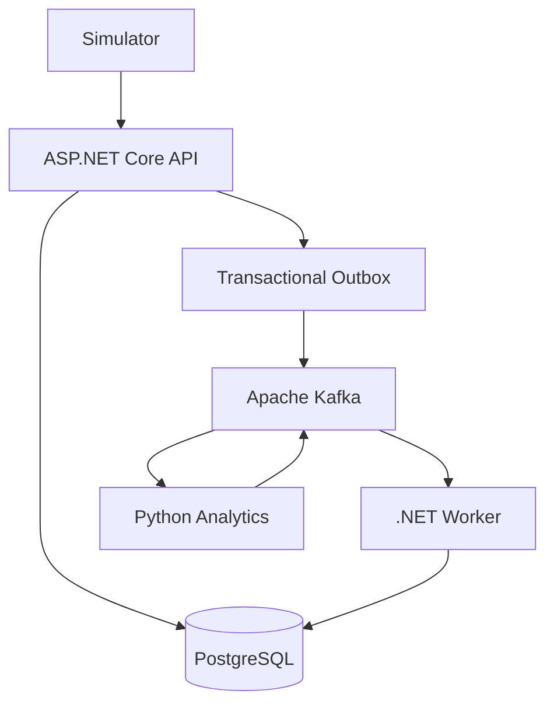

# 🚛 FleetCare

**FleetCare** — система мониторинга состояния автопарка, анализа телеметрии транспортных средств и автоматизации технического обслуживания.

Система позволяет отслеживать техническое состояние автомобилей, выявлять потенциальные неисправности, контролировать интервалы обслуживания и управлять ремонтными заявками.

## 🚀 Основные возможности

### Мониторинг транспорта
- Сбор и хранение телеметрии автомобилей.
- Отслеживание пробега и температуры двигателя.
- Регистрация кодов неисправностей.
- Просмотр истории показаний и состояния транспортных средств.

### Управление техническим обслуживанием
- Контроль интервалов планового ТО.
- Автоматическое создание заявок на обслуживание.
- Управление статусами ремонтных заявок.
- Предотвращение создания дублирующихся заявок.

### Анализ технического состояния
- Анализ температурных показаний двигателя.
- Обнаружение аномалий и потенциальных неисправностей.
- Выявление устойчивых отклонений от нормальных значений.
- Формирование предупреждений для диспетчера.

Python-аналитика температурных отклонений и страница
`/dashboard/risks` реализованы. [Как запустить и проверить](docs/analytics.md).

### Обработка событий
- Асинхронный обмен сообщениями через Apache Kafka.
- Надёжная публикация событий с использованием Transactional Outbox.
- Защита от повторной обработки сообщений.
- Восстановление обработки после сбоев.

## 🛠 Технологический стек

| Категория | Технологии |
|---|---|
| Backend | C#, .NET 10, ASP.NET Core |
| ORM | Entity Framework Core |
| Database | PostgreSQL |
| Message Broker | Apache Kafka |
| Background Processing | .NET Worker Service |
| Analytics | Python |
| Testing | xUnit, Testcontainers |
| Containerization | Docker, Docker Compose |
| Orchestration | Kubernetes, Helm |
| Monitoring | Grafana, OpenTelemetry |

## 🏗 Архитектура

FleetCare построен на принципах разделения ответственности между компонентами системы.

**Основные компоненты:**

- **FleetCare.Api** — REST API для приёма телеметрии, управления автомобилями и ремонтными заявками.
- **FleetCare.Worker** — фоновая обработка событий и выполнение бизнес-правил.
- **FleetCare.Domain** — доменные сущности и бизнес-логика.
- **FleetCare.Infrastructure** — взаимодействие с PostgreSQL, Kafka и другими инфраструктурными компонентами.
- **Python Analytics** — анализ телеметрии и обнаружение аномалий.
- **Simulator** — генерация телеметрических данных транспортных средств.

### Схема взаимодействия компонентов



Подробное описание архитектуры находится в [docs/architecture.md](docs/architecture.md).

## 📁 Структура проекта

```text
FleetCare/
├── src/
│   ├── FleetCare.Api/
│   ├── FleetCare.Worker/
│   ├── FleetCare.Domain/
│   └── FleetCare.Infrastructure/
├── analytics/
├── simulator/
├── tests/
│   └── FleetCare.Domain.Tests/
├── deploy/
│   ├── compose/
│   └── k8s/
├── docs/
│   └── architecture.md
└── FleetCare.sln
```

## ⚙️ Принципы работы

**Надёжность.** Обработка сообщений с защитой от потери событий и возникновения дублирующихся заявок.

**Масштабируемость.** Независимая обработка телеметрии с использованием фоновых сервисов и брокера сообщений.

**Разделение ответственности.** Бизнес-логика изолирована от инфраструктуры и механизмов хранения данных.

**Наблюдаемость.** Централизованное логирование и мониторинг состояния компонентов системы.
