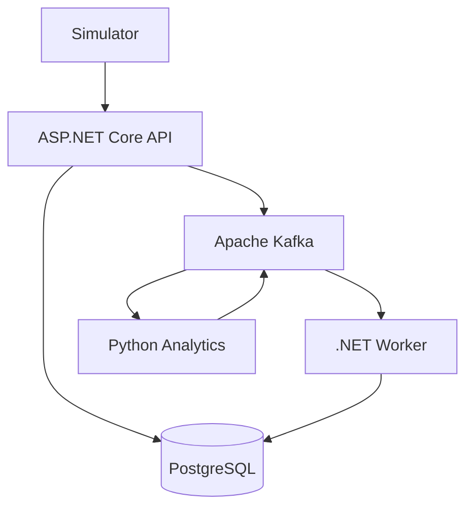

# Архитектура FleetCare

## Назначение компонентов

- FleetCare.Api — принимает HTTP-запросы и сохраняет телеметрию.
- FleetCare.Worker — обрабатывает события и применяет правила ТО.
- FleetCare.Domain — бизнес-сущности и правила.
- FleetCare.Infrastructure — работа с PostgreSQL и Kafka.
- analytics — анализ температурных аномалий на Python.
- simulator — генерация показаний машин.

## Будущая схема взаимодействия

## Главные принципы

1. Domain не зависит от инфраструктурных технологий.
2. События обрабатываются с защитой от дублирования.
3. Принятая телеметрия не теряется при временных сбоях Kafka.
4. Аналитика Python отделена от бизнес-правил .NET.
5. Вся демонстрационная телеметрия создаётся симулятором.